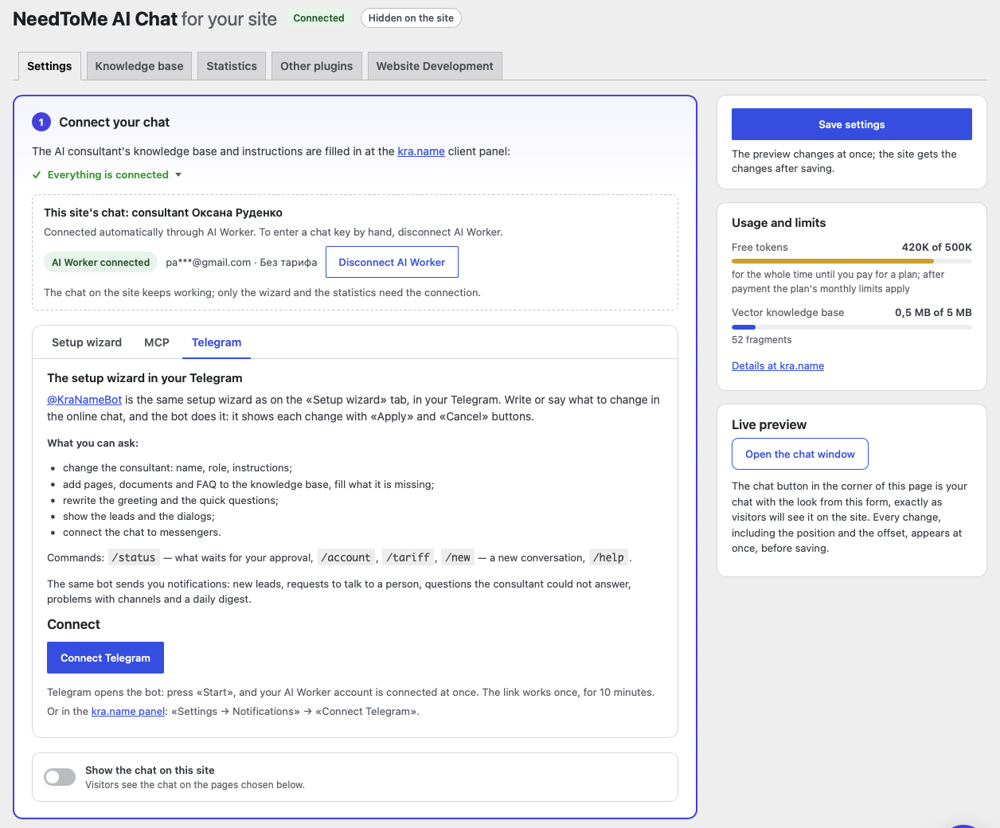
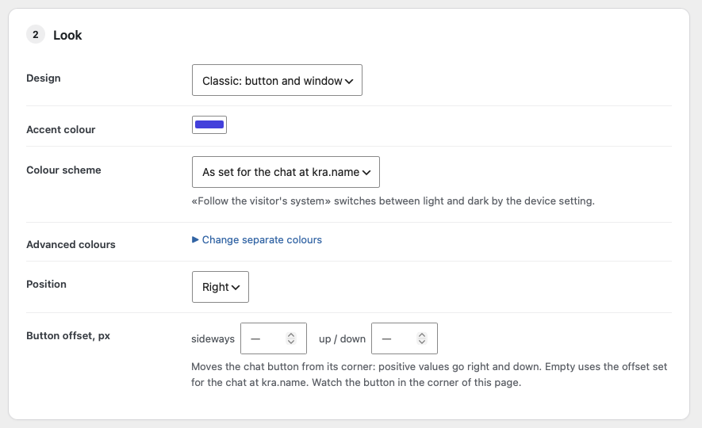
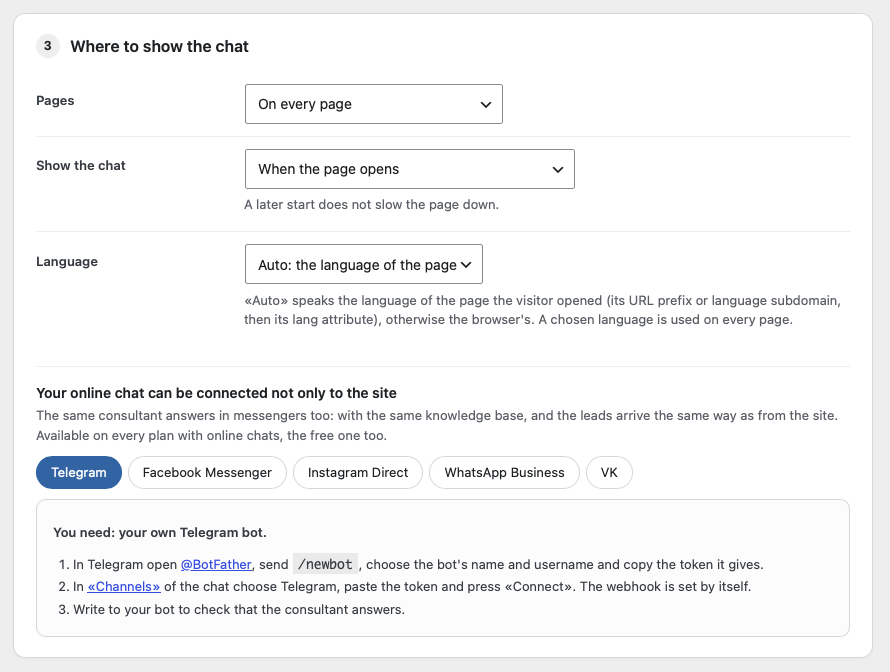
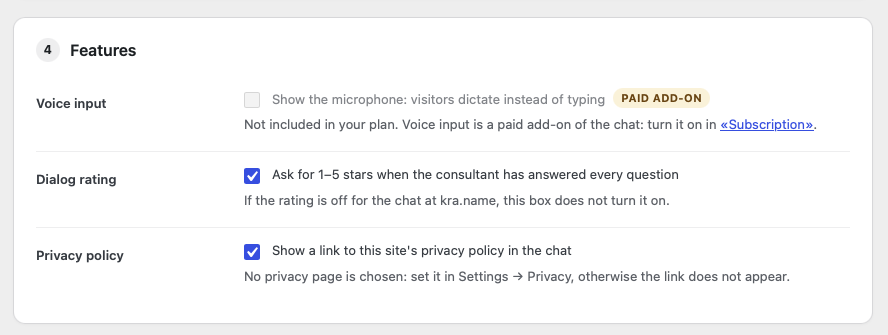
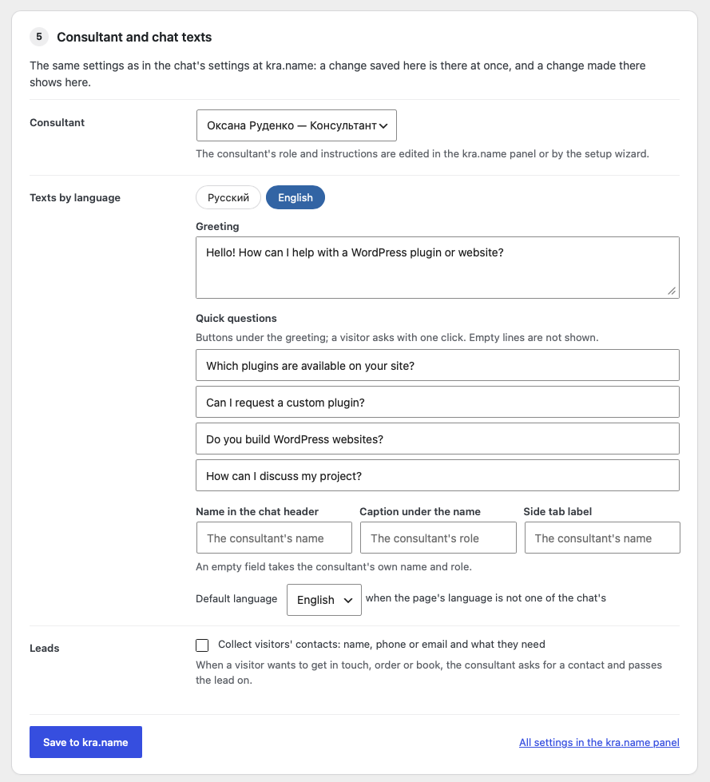
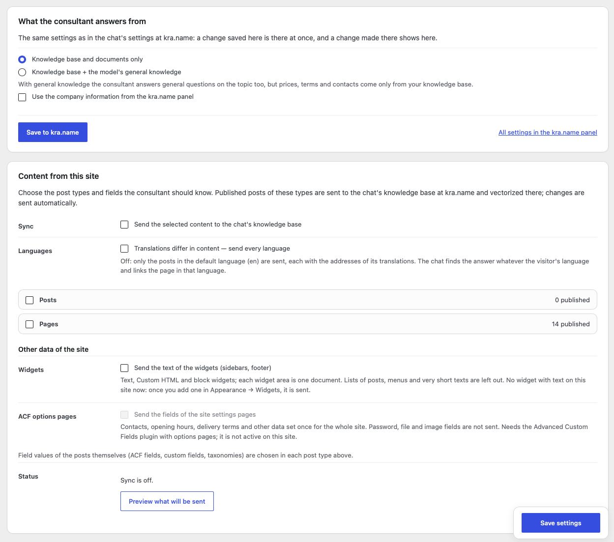
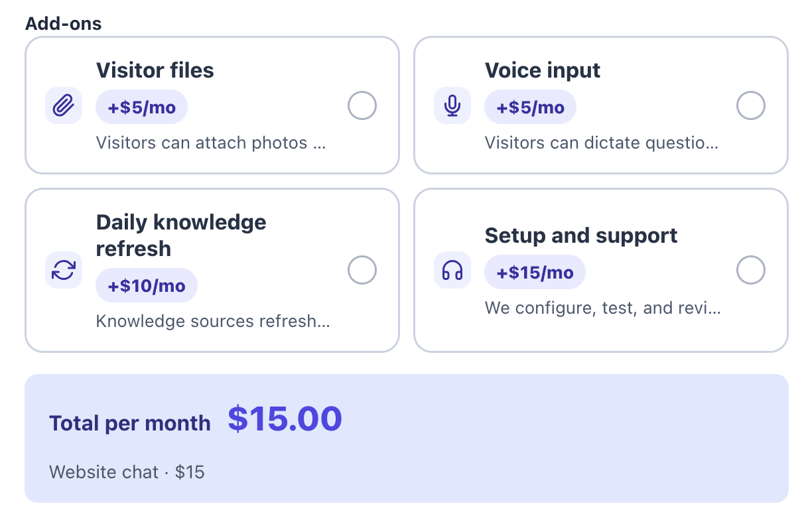
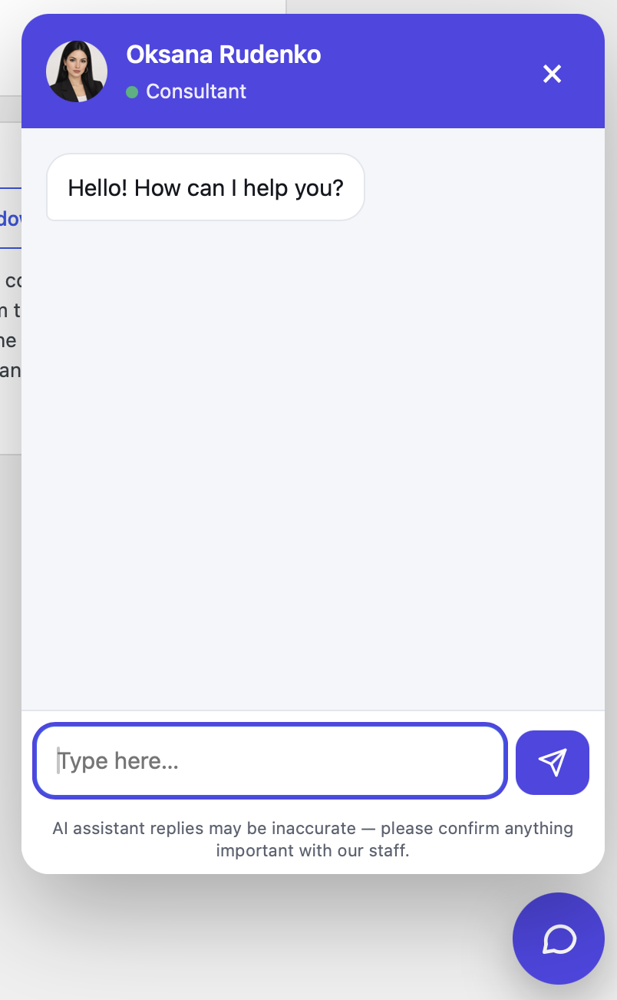
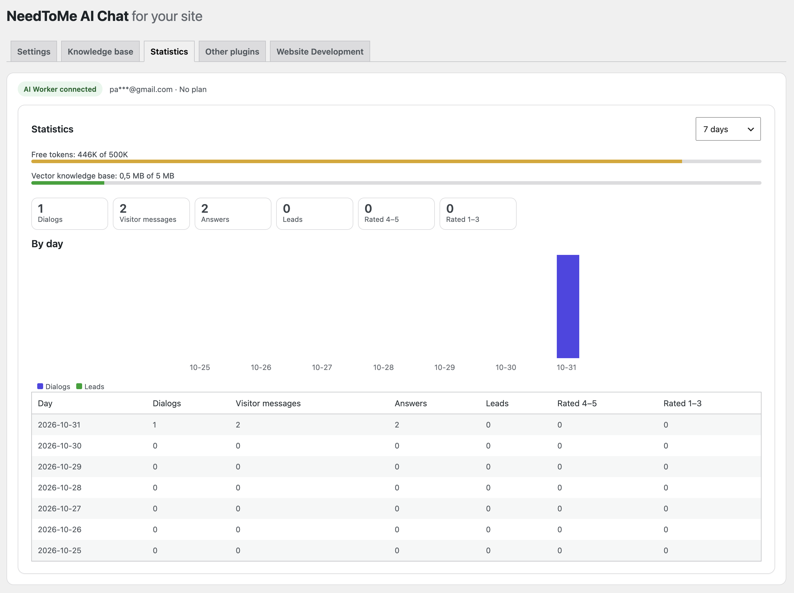

# NeedToMe AI Chat for Your Site

A WordPress plugin that puts an AI consultant on your site. It answers visitors around the clock from your knowledge base (site pages, products, documents, price lists and your own answers), speaks the visitor's language, collects leads and hands a dialog over to a person when needed.

The chat, its knowledge base and the leads live at [kra.name](https://kra.name/) (AI Worker): an account there is required. The plugin connects the site with one button and lets you set up the chat right in WordPress.

- [Live demo and plugin guide](https://needtome.com/needtome-ai-chat/)
- Current source version: **0.10.2**; requires WordPress 6.4+ and PHP 7.4+.

## What you set in WordPress

- The chat's look, position, loading mode, language and the pages it appears on; an inline chat with the `[aiworker_chat]` shortcode.
- The consultant and the chat texts in every language: greeting, quick questions, name and caption, the AI notice and the greeting on page open.
- Leads and where they go: e-mail, Telegram, Slack, Microsoft Teams, Discord, Google Sheets, Notion, a CRM or a webhook.
- The knowledge base: posts, pages, WooCommerce products, ACF fields and widgets sent from the site, plus sources and questions and answers.
- A setup wizard with voice input, usage limits and statistics.

Install: copy this folder to `wp-content/plugins/aiworker-chat` (or upload it as a ZIP), activate the plugin and open **NeedToMe → AI Chat**. Details on data sent to kra.name are in [readme.txt](readme.txt) under «External services».

## Screenshots

### Connect with one button: the chat linked through AI Worker, the setup wizard (with MCP and Telegram) and the usage limits

### The chat's look: design, colours, colour scheme, position and offset of the button

### Where the chat appears, when it loads, its language, and connecting it to messengers

### Features: voice input, dialog rating and the privacy policy link

### The consultant, greeting and quick questions in every language, synced with kra.name

### Knowledge base: what the consultant answers from and the content sent from this site

### The chat's plan and paid add-ons at kra.name

### The chat on the site: the consultant's window with the greeting

### Statistics: dialogs, visitor messages, answers, leads and ratings by day

## Custom development and support

Custom WordPress plugin and website development is available at **$30/hour**. See [NeedToMe](https://needtome.com/) to get in touch.

Support further plugin development via [DonationAlerts](https://www.donationalerts.com/r/needtome) or [Patreon](https://patreon.com/needtome).

## License

GPL-2.0-or-later. See [LICENSE](LICENSE).
